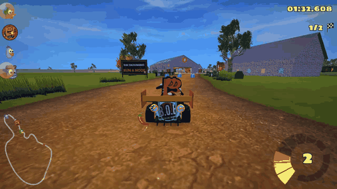
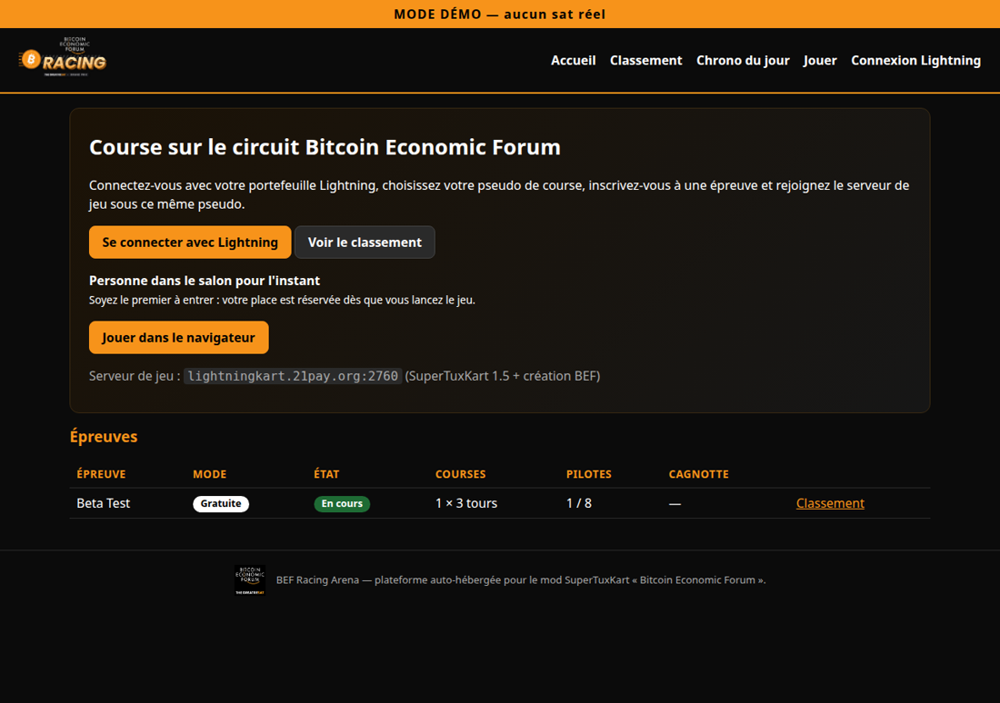
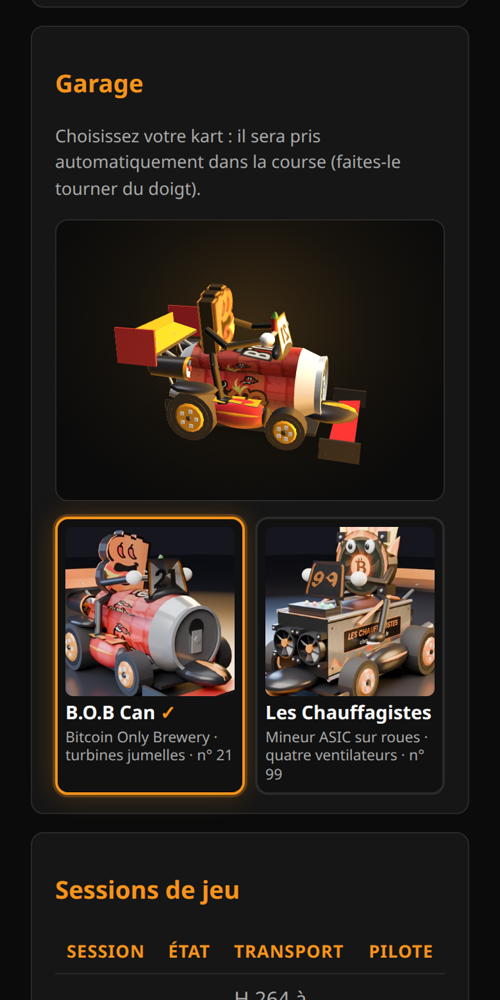
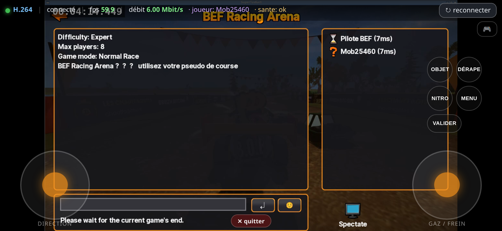
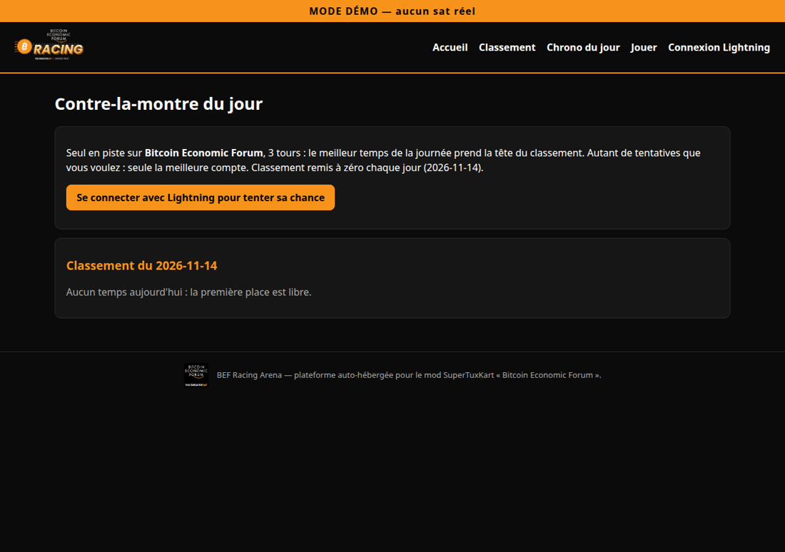

# LightningKart — BEF Racing Arena

**Une arène de course SuperTuxKart en ligne, dans le navigateur, sans rien télécharger.**
On ouvre un lien, on choisit son pseudo, on roule. Connexion Lightning, épreuves, cagnotte,
classement — et le vrai jeu SuperTuxKart diffusé depuis un GPU.

> **BEF** = *Bitcoin Economic Forum*, l'événement dont ce circuit reproduit le lieu : 1,7 km de piste
> qui traversent le bar, deux karts maison, une seule map. Le mod SuperTuxKart et l'arène en ligne
> qui va avec.

## 🏁 Jouer maintenant

**→ [lightningkart.21pay.org/jouer](https://lightningkart.21pay.org/jouer)**

1. Ouvrir le lien (téléphone ou ordinateur)
2. « Connexion de démonstration » — aucun portefeuille, aucun mot de passe, aucun sat réel
3. Choisir un **pseudo de course**, puis « Jouer dans le navigateur »

Sur téléphone, **mettre l'écran en paysage** : deux joysticks apparaissent (direction à gauche,
gaz/frein à droite) avec cinq boutons compacts. Une manette Bluetooth appairée au téléphone ou au PC
est reconnue automatiquement. Une course dure environ deux minutes ; si une est en cours, le salon
affiche le temps d'attente.

**Aucune installation, aucun compte, aucune donnée personnelle.**

## Ce que c'est

- **Le vrai jeu, pas une imitation.** SuperTuxKart 1.5 tourne sur un serveur, encodé en H.264 par le
  GPU et décodé par le navigateur (WebCodecs). On voit la vraie course, les vrais karts, la vraie piste.
- **Une session par joueur.** Chacun obtient son propre écran, son kart et **son pseudo dans le salon** —
  les joueurs se retrouvent donc réellement ensemble sur la piste.
- **Un circuit unique, fait maison** : *Bitcoin Economic Forum*, 1,7 km, avec deux karts maison
  (**B.O.B Can** et **Les Chauffagistes**). Aucun kart standard : l'édition ne contient que ça.
- **Un vrai menu, dans le navigateur** : garage 3D pour choisir son kart (on le fait tourner au doigt),
  salon avec la liste des pilotes et un bouton « Je suis prêt », feux de départ, HUD (tour, chrono,
  place), podium à l'arrivée.
- **Le son du jeu** arrive aussi dans la page : musique et effets, dès le premier appui.
- **Un contre-la-montre du jour** avec son classement, et un **grand écran** en lecture seule pour
  projeter une soirée.
- **Tout se pilote au doigt** : appuyer sur l'écran clique dans le jeu (choix du kart, menus), un bouton
  💬 permet d'écrire dans le chat du salon, même sans clavier.

*Le garage : le kart se choisit au doigt, il sera pris automatiquement dans la course.*

## En chiffres (mesurés)

| | |
|---|---|
| Fluidité | **60 images par seconde**, 6 Mbit/s par joueur |
| Son | relayé dans la page, −25,8 dBFS (musique réelle, pas du silence) |
| Latence verre à verre | **53 ms** (±16 ms) |
| Joueurs simultanés mesurés | **4** sessions à 60 i/s chacune (2,2 Go de mémoire GPU au total) |
| Démarrage d'une session | ~8 secondes |
| Piste | 1,7 km, ~1,33 million de faces |

▶️ **[Vidéo de démonstration](media/demo-course.mp4)** (18 s, sans son)

## Ce que ce n'est pas

- **Pas un jeu à télécharger** : tout se passe dans le navigateur. Une version téléchargeable de
  l'édition existe pour ceux qui veulent jouer hors ligne, sur demande.
- **Le mode actuel est une démonstration** : aucune pièce n'est encaissée, aucun sat n'est mis en jeu.
  Le site l'affiche en haut de page.
- **Le chat n'existe que dans le salon**, avant et après la course — pas pendant : c'est ainsi que
  SuperTuxKart fonctionne.
- **Une seule carte graphique** derrière : quatre joueurs confortablement, au-delà la latence monte.
- Testé sur ordinateur et en émulation tactile Android/iOS-like ; un essai sur un appareil iOS physique
  reste à faire.

## Crédits

- **SuperTuxKart** et ses ressources : © SuperTuxKart Development Team, **GPL v2 ou ultérieure**
  ([supertuxkart.net](https://supertuxkart.net)). Le circuit et les karts de cette arène sont des
  créations originales, distribuées sous la même licence lorsqu'elles accompagnent le jeu.
- **Circuit « Bitcoin Economic Forum »** et karts **B.O.B Can** / **Les Chauffagistes** : création
  Silexperience, calée sur le plan réel du lieu — la piste traverse le bar.
- **Plateforme** (arène web, streaming, ingestion des résultats, paiements Lightning) : code non publié.
  Ce dépôt est une **vitrine** : captures, vidéo et chiffres.

## Contact

Une question, une partie privée, une envie de tester avec un groupe ?
[Ouvrir une discussion](../../issues) sur ce dépôt.

---

Projet auto-hébergé et autofinancé — aucun mécénat, aucune publicité, aucune télémétrie.
